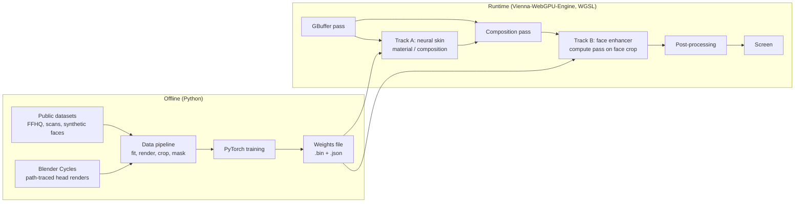

# Project plan: Real-time neural face rendering in WebGPU

Draft for discussion with the supervisor (Prof. Hlavacs). Last updated: 24 November 2026.

> This plan lives in my fork of the supervisor's engine,
> [mahdyfalah/Vienna-WebGPU-Engine](https://github.com/mahdyfalah/Vienna-WebGPU-Engine), where all runtime work
> happens. It replaces an earlier plan (rebuild DLSS 5-style kernels in Vulkan and check them against the
> OpenDLSS-NR model), which is kept in [mahdyfalah/VulkanNR](https://github.com/mahdyfalah/VulkanNR) together with
> the background research on that topic.

## 1. Summary

Small neural networks can run inside a real-time renderer and replace parts of the shading that are too expensive
or too hard to write by hand. This thesis applies that idea to **one well-defined object class: human faces**.

I will train my own networks from **publicly available data** (photographs and scanned or rendered faces), and run
them inside the supervisor's [Vienna-WebGPU-Engine](https://github.com/hlavacs/Vienna-WebGPU-Engine) as WGSL
shaders. The goal is to make a computer-generated face look more like a real photograph in real time, on any GPU
and in the browser.

**Research question:** How close can a small, face-specific neural network get to offline (path-traced or real
photographic) quality for faces in a real-time WebGPU renderer, and what does it cost in GPU time on different
devices?

## 2. Instructor feedback this plan answers

Notes from the last meeting with the supervisor:

- The model can be trained on real photographs (focus on people's faces).
- Try to improve a face that exists but is not realistic, or try to complete a face (empty head).
- Get familiar with every link and describe the architecture.
- Research and decide between WebGPU and Vulkan; the Vienna-WebGPU-Engine may be extended.
- Train my own models and weights, using publicly available data.

| Feedback | How the plan answers it |
| --- | --- |
| Train my own models and weights | All networks are trained by me in PyTorch; no third-party weights are used at runtime |
| Focus on faces, using public data | Faces only; data from public datasets and scans (section 7) |
| Model can be trained on real photographs | Track B uses real photographs (FFHQ/CelebA-HQ) as the target appearance |
| Improve a face that exists but is not realistic | Track B: a screen-space face enhancer that turns a coarse CG face into a photoreal one |
| Try to complete a face (empty head) | Stretch goal S1: neural completion of missing face regions |
| Get familiar with every link and describe the architecture | Section 3 |
| Decide between WebGPU and Vulkan | Section 4: WebGPU, using the Vienna engine; Vulkan only as an optional comparison |

## 3. Related work (links from the supervisor)

| Project | What it does | Architecture | What I take from it |
| --- | --- | --- | --- |
| [Utsubo neural cheetah](https://utsubo-neural.utsubo.io/) | A furry cheetah rendered live in the browser at 60 fps by a neural network | A small network trained on offline Blender Cycles renders of one specific asset (the real fur groom). At runtime the network runs per pixel in WebGPU instead of the expensive fur rendering | Proof that a network trained on offline renders of **one asset** runs in real time on WebGPU in the browser. Track A follows this pattern for a face |
| [Neural Shaders, Explained With Clouds](https://charlesgrassi.dev/blog/neural-volumetric-clouds/) (C. Grassi) | Volumetric clouds where one lighting term is predicted by a network | A tiny MLP (about 500 multiply-adds) called at every ray-march step. It replaces the hand-tuned multiple-scattering approximation and is trained against a path tracer. Written in HLSL/Unity | The evaluation method: replace **one** part of the shader, then measure error against the ground truth and GPU cost (about 10% error vs. up to 10× for the old approximation, for about 20% more GPU time). I use the same kind of measurement |
| [How to Get Started with Neural Shading](https://developer.nvidia.com/blog/how-to-get-started-with-neural-shading-for-your-game-or-application/) (NVIDIA blog) | Introduction to neural shading tools | Slang with automatic differentiation; cooperative vectors that map matrix-vector products to Tensor Cores; the [RTX Neural Shaders SDK](https://github.com/NVIDIA-RTX/RTXNS); neural texture compression; neural materials (an encoder turns material textures into latent textures that a small decoder MLP reads at runtime) | The neural material idea (latent texture + small decoder MLP) is the basis of Track A. Slang is an optional tool for writing the network once and compiling to WGSL and SPIR-V |
| [Neural Shading course, SIGGRAPH 2025](https://research.nvidia.com/labs/rtr/publication/duca2025neural/) (Duca et al.) | A three-hour course from theory to deployment | Optimisation basics; fitting a texture with a small MLP; tricks that make small networks work (input encodings, activations, learning-rate schedules); hardware acceleration with cooperative vectors; deployment in C++; neural texture compression and neural appearance | The training recipe for small networks, and the list of tricks to try in my ablations |
| [Vienna-WebGPU-Engine](https://github.com/hlavacs/Vienna-WebGPU-Engine) ([live demos](https://hlavacs.github.io/Vienna-WebGPU-Engine/)) | The supervisor's C++17 WebGPU engine for teaching | wgpu-native or Dawn backends, also builds for the browser with Emscripten. Deferred renderer with a render graph (Shadow, GBuffer, ClusterCompute, Composition, Skybox, ForwardTransparency, PostProcessing, Debug), PBR, IBL, clustered lights, cascaded shadows, scene graph, hot reload, ImGui | The host engine. My work adds new render passes and materials to my fork of it |

Also relevant as background (my earlier research): [OpenDLSS-NR](https://github.com/maanHimself/OpenDLSS-NR), an
open reimplementation of a DLSS-style neural renderer. I do not copy it. It shows how a whole-frame network is
put into a render pipeline, and it shows why a whole-frame model is too large for this thesis. That is one reason
for the narrower face-only scope.

**Common thread:** each project uses a **small, specialised network running inside a shader**, trained offline on
high-quality data (path tracing, offline renders or photographs). This thesis does the same for faces.

## 4. Graphics API decision: WebGPU (with the Vienna engine)

| Criterion | WebGPU (Vienna engine) | Vulkan (my own engine) |
| --- | --- | --- |
| Starting point | A working deferred renderer with G-buffer, lighting, post-processing and ImGui | A compute template only; months of setup code before any face work |
| Portability (Windows, Linux handheld, Mac, browser) | Built in (wgpu-native/Dawn → Vulkan, Metal, D3D12; Emscripten → browser) | Mac needs MoltenVK; no browser |
| Tensor Cores (cooperative matrix/vector) | Not in standard WebGPU (only experimental extensions) | Available (`VK_KHR_cooperative_matrix`, `VK_NV_cooperative_vector`) |
| Half precision and subgroups | Optional features (`shader-f16`, `subgroups`); must be checked on each device | Available |
| Shader language | WGSL (or Slang → WGSL) | GLSL/HLSL/Slang → SPIR-V |
| Supervision and reuse | The supervisor's engine; the result can go back into it | Separate code base |
| Matches related work | Utsubo cheetah runs on WebGPU | RTXNS and the NVIDIA course target Vulkan/D3D12 |

**Decision:** WebGPU in a fork of Vienna-WebGPU-Engine. A face-only network is small and only runs on the
face region, so Tensor Cores are not required to reach real-time speed. Training happens offline in PyTorch, so
WebGPU only needs to run inference.

**Optional comparison (milestone 7):** run the same network as SPIR-V on Vulkan with cooperative matrices on the
RTX 4070 Ti, to measure how much speed WebGPU gives up. The Vulkan compute template already written in
[mahdyfalah/VulkanNR](https://github.com/mahdyfalah/VulkanNR) is reused for that.

## 5. Goals

### 5.1 Primary goals

1. **G1, Neural skin shader (Track A):** a per-pixel MLP that shades a scanned head and is trained on path-traced
   renders of that head. It should look closer to the path-traced reference than the engine's PBR shader at
   real-time cost.
2. **G2, Neural face enhancer (Track B):** a screen-space network that takes the G-buffer of a coarse CG face and
   outputs a more photoreal face. It is trained on real photographs paired with coarse 3D face fits.
3. **G3, Engine integration:** both networks run as render passes in the Vienna engine, can be switched on and
   off in ImGui, and load weights that I trained myself.
4. **G4, Evaluation:** measured image quality, temporal stability and GPU cost on several devices and backends.

### 5.2 Secondary goals

- Browser demo (Emscripten build) of at least Track A.
- Ablations: network width and depth, input features, input encodings, fp16 vs. fp32.

### 5.3 Stretch goals

- **S1, Face completion ("empty head"):** fill missing or untextured face regions with a network trained for
  inpainting.
- **S2, Vulkan/Slang comparison:** the same network with cooperative matrices on Vulkan (section 4).
- **S3, Temporal input:** feed the previous frame (reprojected with motion vectors) into the enhancer to reduce
  flicker.

### 5.4 Non-goals

- No whole-frame upscaling or denoising (DLSS-style); only the face region is processed.
- No training inside the engine; training happens in PyTorch.
- No identity swapping, no deepfakes of real people, no generation of new identities from photographs.
- No large generative models (diffusion, StyleGAN) at runtime; at most, they may be used offline to create data.

## 6. What will be implemented

### 6.1 System overview

### 6.2 Engine work (my fork: [mahdyfalah/Vienna-WebGPU-Engine](https://github.com/mahdyfalah/Vienna-WebGPU-Engine))

- A new example project `examples/neural_face` with a head model, lights, an orbit camera and ImGui controls.
- **Weight loader:** reads a simple binary file (fp16 or fp32 tensors) with a JSON header (layer names, shapes,
  normalisation values) and uploads it as a storage buffer.
- **WGSL inference library:** dense layer, 3×3 convolution, activations (ReLU, LeakyReLU, sine, sigmoid),
  down- and upsampling, and input encodings (frequency and hash-grid), written as reusable WGSL functions.
- **Track A pass:** a neural skin material inside the deferred pipeline (extra G-buffer data and a custom
  composition branch).
- **Track B pass:** a compute pass after composition. It finds the face bounding box from a face mask in the
  G-buffer, runs the network on a fixed-size crop (for example 256² or 512²), and blends the result back with a
  soft mask.
- **Debug and capture tools:** show inputs and outputs of each pass, save screenshots and G-buffer images, and
  record GPU time with timestamp queries (using the engine's frame profiler where it supports this).
- Feature detection for `shader-f16` and `subgroups`, with a fallback to fp32.

### 6.3 Track A: neural skin shader (low risk, follows the related work)

- **Asset:** one scanned head, for example the Lee Perry-Smith head scan (Infinite Realities, CC BY 3.0).
- **Ground truth:** Blender Cycles path-traced renders with subsurface scattering (Principled BSDF random walk),
  many light directions and many camera directions.
- **Network:** a learned latent texture in UV space (for example 8 channels), plus encoded normal, view direction
  and light direction, goes into a small MLP (2–3 hidden layers, 32–64 neurons) that outputs RGB radiance for one
  light. Several lights are summed. This follows the neural-materials design from the NVIDIA blog and course.
- **Baseline:** the same head with the engine's PBR shader.
- **Target:** clearly lower error against the path-traced reference than PBR, for less than about 2 ms at 1080p
  on the RTX 4070 Ti.

### 6.4 Track B: neural face enhancer (the "real photographs" part)

- **Input (per pixel, face crop):** albedo, normal, depth, a face-region mask, and the plain shaded colour from
  the engine.
- **Output:** an RGB image of the face crop that looks photoreal, blended into the frame.
- **Network:** a small U-Net (3–4 levels, 16–64 channels) that runs as a chain of WGSL compute passes. If this is
  too slow, use a per-pixel MLP with a few small convolution layers.
- **Training (supervised, so no unstable GAN-only setup):**
  1. Take a real photograph from a public dataset.
  2. Fit a 3D face model (FLAME, using DECA or EMOCA) to the photograph. This gives shape, pose, expression,
     a coarse albedo and the lighting.
  3. Render this coarse fit with the **engine's own shading**, so that training inputs match what the engine
     outputs at runtime.
  4. Train the network to map (render + G-buffer) → photograph, with L1 + LPIPS loss and optionally a small
     adversarial loss at the end.
- **Target:** clearly more realistic than the input render (FID/KID and LPIPS), while keeping the same identity
  and pose, at less than about 4 ms per face on the RTX 4070 Ti.

### 6.5 Stretch S1: face completion ("empty head")

- Train the Track B network with randomly masked regions (holes in albedo, missing texture, or a blank head)
  so that it learns to fill them with a plausible face.
- Demo: a head mesh without a texture gets a plausible skin and face appearance at runtime.
- Risk: this is generative and much harder to evaluate. It is only done if Tracks A and B work.

### 6.6 Python tooling (new folder `training/` in this repository, next to the engine code)

- `data/`: dataset download scripts, face fitting, Blender render scripts, train/validation/test split.
- `models/`: PyTorch definitions of the Track A and Track B networks.
- `train.py`, `export_weights.py` (writes the `.bin` + `.json` format the engine reads).
- `reference_infer.py`: runs the exported weights in PyTorch on fixed inputs, to check the WGSL results
  (section 8.1).
- `eval/`: metric scripts (PSNR, SSIM, LPIPS, FID/KID, identity similarity, flicker).

## 7. Training data

All datasets below are public, but most are **for non-commercial research only**. That is fine for a thesis, but
each licence must be checked and cited before use. No dataset images are committed to git.

| Data | Type | Use | Licence (to verify) |
| --- | --- | --- | --- |
| [FFHQ](https://github.com/NVlabs/ffhq-dataset) | 70k aligned high-quality face photos | Track B targets (real photos) | CC BY-NC-SA 4.0 (dataset); images under their own Flickr licences |
| [CelebA-HQ / CelebAMask-HQ](https://github.com/switchablenorms/CelebAMask-HQ) | 30k face photos + 19-class face parsing masks | Track B targets; masks for skin, eyes, hair | Non-commercial research |
| [FLAME](https://flame.is.tue.mpg.de/) + [DECA](https://github.com/yfeng95/DECA) / [EMOCA](https://github.com/radekd91/emoca) | 3D face model + fitting from one image | Make coarse 3D fits of photos (Track B inputs) | Non-commercial research (registration required) |
| [Microsoft Face Synthetics](https://github.com/microsoft/FaceSynthetics) | 100k synthetic CG faces with labels | Extra CG-style inputs; segmentation labels | Research use only |
| [Lee Perry-Smith head scan](https://www.thingiverse.com/thing:30770) (Infinite Realities) | Scanned head mesh with textures | Track A asset; Cycles ground truth | CC BY 3.0 |
| [Multiface](https://github.com/facebookresearch/multiface) (Meta) | Multi-view captures of faces with meshes | Optional: multi-view ground truth for Track A | CC BY-NC 4.0 |
| [FaceScape](https://facescape.nju.edu.cn/) | 3D face scans with textures | Optional: more heads for Track A | Non-commercial; application required |
| Own Blender renders | Path-traced images of the scanned heads | Track A ground truth | My own |

**Data pipeline steps:**

1. Download and align faces (the datasets are already aligned; I crop to the network input size).
2. Get face masks with the dataset's parsing masks, or with a face-parsing network (for example BiSeNet).
3. Fit FLAME with DECA/EMOCA and render the fit with the engine's shading model (a Python copy of the shader, or
   images captured from the engine itself).
4. Split by identity into train, validation and test sets, so the same person never appears in two sets.
5. For Track A, render about 5–20k Cycles images (random light and camera directions) plus matching G-buffers.

**Ethics:** only public research datasets are used, only for research, and no identity editing or swapping is
done. Example images in the thesis come from datasets whose licence allows it, or from synthetic or scanned heads.

## 8. What will be tested

### 8.1 Correctness of the WGSL inference

- For each layer type and each whole network: run the same fixed inputs through PyTorch and through the engine,
  and compare the outputs.
- Pass criteria: maximum absolute error below about 1e-4 in fp32 and below about 1e-2 in fp16.
- Run automatically on the RTX 4070 Ti (wgpu and Dawn backends) and in the browser.

### 8.2 Image quality

| Test | Track | Metric | Compared against |
| --- | --- | --- | --- |
| Accuracy against path tracing | A | PSNR, SSIM, LPIPS, FLIP | PBR shader vs. neural shader, both against Cycles |
| Generalisation to unseen lights and views | A | Same metrics on a held-out set of light and camera directions | Training views |
| Realism | B | FID / KID against held-out real photos | Input render vs. enhanced output |
| Reconstruction | B | LPIPS, PSNR on held-out (render, photo) pairs | Input render |
| Identity kept | B | Cosine similarity of face-recognition embeddings (for example ArcFace) between input and output | Input render |
| Visual comparison | A, B | Side-by-side images and videos; an optional small user study | PBR / input render |

### 8.3 Temporal stability

- Render a camera orbit and a moving light. Measure flicker as the difference between each frame and the
  previous frame warped with motion vectors (optionally tLPIPS).
- This matters mainly for Track B, because a per-frame network can flicker.

### 8.4 Performance

- GPU time per pass with timestamp queries, plus total frame time.
- Variables: resolution (720p, 1080p, 1440p), crop size, network width, fp16 vs. fp32, subgroups on or off,
  workgroup size.
- Devices and backends:

| Device | OS | Backend |
| --- | --- | --- |
| Desktop with RTX 4070 Ti | Windows | wgpu (Vulkan), Dawn (D3D12/Vulkan), browser (Chrome) |
| Handheld gaming PC | Linux | wgpu (Vulkan) |
| Mac | macOS | wgpu/Dawn (Metal), browser (Safari/Chrome) |
| Optional: RTX 4070 Ti | Windows | Vulkan + cooperative matrices (S2) |

### 8.5 Ablations

- Network size (width and depth) vs. quality vs. GPU time.
- Input features: with and without normal, depth, view direction and latent texture.
- Input encoding: raw, frequency, hash-grid.
- Loss: L1 only vs. L1 + LPIPS vs. + adversarial loss (Track B).

## 9. Tech stack

| Area | Tools |
| --- | --- |
| Engine | [Vienna-WebGPU-Engine](https://github.com/hlavacs/Vienna-WebGPU-Engine) (C++17), my fork [mahdyfalah/Vienna-WebGPU-Engine](https://github.com/mahdyfalah/Vienna-WebGPU-Engine) |
| WebGPU implementations | wgpu-native v29 (main), Dawn (comparison), emdawnwebgpu with Emscripten (browser) |
| Shaders | WGSL; optional [Slang](https://shader-slang.org) to compile the same code to WGSL and SPIR-V |
| Engine libraries | SDL3, ImGui, GLM, spdlog, tinygltf |
| Build | CMake, Ninja, MSVC 2022 Build Tools (Windows), Clang (Linux, macOS), Emscripten (web) |
| Training | Python 3.11, PyTorch, torchvision, NumPy |
| Data | Blender (Cycles) with Python scripts, DECA/EMOCA + FLAME, a face-parsing network |
| Evaluation | `lpips`, `torchmetrics` (PSNR, SSIM, FID, KID), NVIDIA FLIP, an ArcFace model for identity |
| Optional comparison | Vulkan 1.3 + `VK_KHR_cooperative_matrix` (code in [mahdyfalah/VulkanNR](https://github.com/mahdyfalah/VulkanNR)) |
| Hardware | RTX 4070 Ti (Windows), handheld gaming PC (Linux), Mac |
| Versioning | Git/GitHub; datasets and large weights are kept out of git |

## 10. Milestones

| # | Milestone | Content | Deliverable | Dates | Status |
| --- | --- | --- | --- | --- | --- |
| 0 | First research phase | Repository and Vulkan compute template; study of DLSS-style neural rendering and OpenDLSS-NR | [mahdyfalah/VulkanNR](https://github.com/mahdyfalah/VulkanNR) (template and architecture notes) | Oct – Nov 2026 | Done |
| 1 | Related work and decisions | Study all supervisor links and describe their architectures (section 3); WebGPU vs. Vulkan decision (section 4); this plan approved | Approved plan | Until mid-Dec 2026 | In progress |
| 2 | Engine setup | Fork built and running (Tutorial done); build `main_demo`; `examples/neural_face` with a head and ImGui; GPU timing; screenshot and G-buffer capture | Face scene running with timing | Dec 2026 – early Jan 2027 | Fork built and running |
| 3 | Inference basics | Weight file format and loader; WGSL dense and conv layers; correctness tests against PyTorch (8.1) | All layer tests pass | January 2027 | To do |
| 4 | Data pipeline | Blender Cycles renders of the scanned head; FFHQ/CelebA download; DECA/EMOCA fits; masks; identity-based splits | Training sets for A and B | Jan – Feb 2027 | To do |
| 5 | Track A: neural skin | Train MLP + latent texture; export; WGSL pass in the engine; compare with PBR and Cycles | Working neural skin, first results | February – mid-March 2027 | To do |
| 6 | Track B: face enhancer | Train small U-Net; compute pass on the face crop; blending; temporal tests | Working enhancer, first results | Mid-March – April 2027 | To do |
| 7 | Optimisation and portability | fp16, subgroups, workgroup tuning; runs on the Linux handheld, the Mac and the browser; optional S2 Vulkan comparison | Performance tables (8.4) | Late April – mid-May 2027 | To do |
| 8 | Evaluation | All tests in section 8, ablations, figures and videos | Results chapter data | May 2027 | To do |
| 9 | Thesis and seminar | Writing, seminar talk, final demo (browser link if possible) | Thesis, talk, demo | May – June 2027 | To do |
| – | Stretch S1 / S3 | Face completion; temporal input | Extra chapter | Only if 5 and 6 are done early | Optional |

The dates are a first estimate and will be agreed with the supervisor. Track A comes before Track B on purpose:
it is smaller, has exact ground truth, and tests the whole chain (data → training → export → WGSL → measurement)
early.

## 11. Risks

| Risk | Impact | What I do about it |
| --- | --- | --- |
| Track B network too slow in WGSL without Tensor Cores | Not real-time | Run only on the face crop; smaller crop and fewer channels; fp16 and subgroups; fall back to a per-pixel MLP |
| Domain gap: training renders do not match what the engine draws | Bad results in the engine | Make the training inputs with the engine's own shading, or with images captured from the engine |
| Fitted 3D faces (DECA) are not exact, so pairs are not pixel-aligned | Blurry outputs | Perceptual loss (LPIPS) instead of only per-pixel loss; small adversarial loss; mask out the background and hair |
| Flicker between frames | Poor video quality | Temporal test (8.3); stretch S3 with the previous frame as input |
| `shader-f16` or `subgroups` missing on a device or in a browser | Slower or broken on that device | Feature detection with an fp32 fallback path |
| Dataset licences (non-commercial, registration) | Cannot use some data | Use only for research; prefer the CC BY scan and my own renders for public images |
| Engine changes upstream | Merge work | Work on a branch in my fork; regularly merge `upstream/main` |
| Not enough GPU memory or time for training | Slow training | Small networks, crops of 256²; mixed precision on the RTX 4070 Ti |

## 12. Questions for the supervisor

1. Do you agree with WebGPU in my fork of your engine, and would you like the work merged back in the end?
2. Tracks A and B both, with A first, or only one of them?
3. Should the Vulkan/cooperative-matrix comparison (S2) stay in, or should Vulkan be dropped completely?
4. Are research-only datasets (FFHQ, CelebA-HQ, FLAME/DECA, Face Synthetics) acceptable for the thesis?
5. Is the timeline (implementation until mid-May, writing in May–June) realistic for the thesis deadline?

## 13. Repositories

| Repository | Purpose |
| --- | --- |
| [mahdyfalah/Vienna-WebGPU-Engine](https://github.com/mahdyfalah/Vienna-WebGPU-Engine) (this repository, local: `thesis/Vienna-WebGPU-Engine`) | Fork of the supervisor's engine; this plan, all runtime work and the Python `training/` folder. `upstream` points to [hlavacs/Vienna-WebGPU-Engine](https://github.com/hlavacs/Vienna-WebGPU-Engine) |
| [mahdyfalah/VulkanNR](https://github.com/mahdyfalah/VulkanNR) (local: `thesis/VulkanNR`) | Earlier Vulkan plan, DLSS architecture notes, Vulkan compute template for the optional comparison (S2) |
| [OpenDLSS-NR](https://github.com/maanHimself/OpenDLSS-NR) (local: `thesis/OpenDLSS-NR`) | Background reading only |
